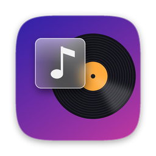

<p align="center"></p>

<h1 align="center">YAME</h1>

<p align="center"><b>Y</b>et <b>A</b>nother <b>M</b>P3 <b>E</b>ditor<br>
<i>Make your MP3s look right in the car.</i></p>

<p align="center">A small, native macOS app for editing song titles, artists, albums and cover art,<br>built with SwiftUI and Liquid Glass.</p>

---

Car stereos are picky. Unless your files are tagged *just so*, they show "Unknown Artist", skip your cover art, or play songs in the wrong order. YAME fixes all of that in one window, and never re-encodes a single byte of audio.

> 🤖 **Written entirely by AI.** Every line of YAME (the code, tests, icon, build scripts and this README) was written by **Claude Opus 5.5** (medium effort), Anthropic's AI model, in a single conversation. A human described what they wanted, tested the app on a real USB drive and car, and reported back. See [About this project](#about-this-project).

## Features

- **Open a folder or individual MP3s.** Pick a folder on your USB drive, drag files onto the window, or right-click an MP3 in Finder → *Open With → YAME*.
- **Live folder updates.** Copy new songs into the open folder, delete or rename some, or change their tags in another app, and YAME updates by itself without losing your unsaved edits.
- **Edit tags:** title, artist, album, album artist, track number / total, year and genre.
- **Cover art with a live preview.**
  - Drop an image on the cover, paste one (⇧⌘V), or choose a file.
  - **Get the thumbnail from a YouTube link.** Black letterbox bars are trimmed automatically.
  - Turn any picture into a square: **crop** (with a slider to choose what stays in frame) or **fit** it on a blurred, white or black background.
  - Saved as a **500 × 500 baseline JPEG** by default, the format car head units read most reliably.
- **Edit many songs at once.** Select several songs to set the same album, album artist, artist, genre, year or cover for all of them.
- **Auto-Number.** Track numbers stay in step with the list by themselves.
  - Add a song to a 50-song playlist and every song becomes "of 51" in its file.
  - Drag a song to a new spot and the numbers in the files update.
  - File names that start with a number ("07 …") are renumbered too.
  - Only the small tag at the start of each file is rewritten, so this is quick even on USB drives.
  - You can turn it off from the toolbar.
- **Play order.** Drag songs in the sidebar, or use **Number & Rename** to:
  - write track numbers ("7 of 50") in that order;
  - rename the files to `01 Artist - Title.mp3`, so cars that sort by file name play them in the right order too.
- **Car-ready check.** Each song shows what might stop it displaying properly: a missing title or artist, a PNG or progressive-JPEG cover, a cover that's too large or not square, and so on.
- **Clean up the drive.** Removes macOS `._` files, `.DS_Store`, and stray non-song files like pasted `.tiff` screenshots that cars list as broken tracks.
- **Safe for USB drives.**
  - File names are cleaned of characters FAT32/exFAT can't store.
  - Accented names are Unicode-normalized so drives don't reject them.
  - **Eject** from the toolbar when you're done.
- **Undo and redo everything** (⌘Z, ⇧⌘Z / ⌘Y): typing, covers, batch edits, reordering, numbering, file renames, and deleting songs or junk files (deleted files go to the Trash, so undo puts them back).
- **Preview playback** to check you're editing the right song.

## Keyboard shortcuts

| Shortcut | Action |
|---|---|
| ⌘O | Open a folder or MP3s |
| ⌘S | Save the selected song(s) |
| ⌥⌘S | Save all |
| ⌘Z | Undo (typing, covers, batch edits, reordering, renames, deletes) |
| ⇧⌘Z or ⌘Y | Redo |
| ⇧⌘V | Paste a cover from the clipboard |
| ⇧⌘Y | Cover from a YouTube link |
| ⇧⌘N | Number & Rename |
| ⇧⌘P | Play / stop a preview |
| ⌘↩ | Save (in the editor) |
| ⌥⌘A | Select all songs |
| ⌘R | Reload the folder |
| ⌘E | Eject the drive |
| ⌫ | Remove the selected songs from the list (files stay on disk) |
| ⌘⌫ | Move the selected songs to the Trash |

Undo works across the whole session. It restores tags, covers and play order, renames files back, and brings deleted files back from the Trash. On drives without a Trash, deleted files wait in a hidden `.yame-trash` folder until you empty it with **Clean Up**. Changes made outside YAME, in Finder for example, aren't part of YAME's undo history.

## System requirements

### To run YAME

| | |
|---|---|
| **Mac** | Apple silicon: M1 or later. Intel Macs aren't supported. |
| **macOS** | macOS 26 Tahoe or later. YAME uses Liquid Glass, which is new in macOS 26. |
| **Disk space** | About 5 MB |
| **Internet** | Only for downloading YouTube thumbnails. Everything else works offline. |
| **Drives** | Any drive macOS can write to: internal, APFS/HFS+, FAT32 or exFAT USB sticks and SD cards |

### To build it yourself

| | |
|---|---|
| **macOS** | macOS 26 Tahoe or later, on Apple silicon |
| **Tools** | **Xcode 26 or later**, *or* just the **Command Line Tools for Xcode 26** or later (`xcode-select --install`) |
| **Swift** | 6.2 or later (included with the tools above) |

## Install

### Download

Get `YAME.zip` from the [Releases](../../releases) page, unzip it, and drag **YAME.app** to Applications.

The app is ad-hoc signed rather than notarized, so the first time you open it, either:

- right-click **YAME.app → Open → Open**, or
- run `xattr -dr com.apple.quarantine /Applications/YAME.app`.

### Build it yourself

```bash
xcode-select --install          # only if you don't have Xcode or the Command Line Tools yet
git clone <this repo> && cd YAME
./scripts/build-app.sh          # → build/YAME.app
open build/YAME.app
```

You can also open `Package.swift` in Xcode and run the **YAME** scheme. Run the tests with `swift test`.

## How tags are written

| | |
|---|---|
| Tag format | ID3v2.3, plus an optional ID3v1 tag for older stereos |
| Text | Latin-1 when possible, otherwise UTF-16 with BOM |
| Cover | One front-cover `APIC` frame |
| Other frames | Comments, lyrics, ReplayGain, etc. are kept; ID3v2.4 and v2.2 tags are converted |
| Audio | Copied byte for byte; never re-encoded |
| Saving | Written to a temp file, then atomically renamed over the original (works on FAT32/exFAT) |

The tag engine (`YAMECore`) is plain Swift with no dependencies. Its unit tests also run on Linux, and it has been checked against `ffmpeg`/`ffprobe`: tags read back correctly and the decoded audio is bit-identical after saving.

## Project layout

```
Sources/YAMECore/       ID3 reader/writer, file naming, folder scan, YouTube ids, car checks
Sources/YAME/Model/     Library (state + folder watching), TrackItem, CoverProcessor
Sources/YAME/Views/     SwiftUI + Liquid Glass interface
Tests/YAMECoreTests/    Tag engine tests
Resources/              Info.plist, app icon
scripts/build-app.sh    Builds and signs YAME.app
```

## About this project

YAME was written from scratch by **Claude Opus 5.5** (Anthropic), running at medium reasoning effort. It grew out of a chat about fixing album names and cover art for a car's USB playlist. After tagging 50 songs by hand, the human asked for an app that does the same job, and Claude wrote all of it:

- the ID3 engine
- the SwiftUI interface
- the tests
- the app icon
- the build and release scripts
- this README

The human's part was the idea, the feature requests, design feedback, and testing builds on their Mac. Bugs found that way went back to Claude to fix.

AI-written code can contain mistakes. YAME never touches the audio in your files, but **keep a backup of your music** before editing a large collection. Issues and pull requests are welcome.

## License

[MIT](LICENSE)
